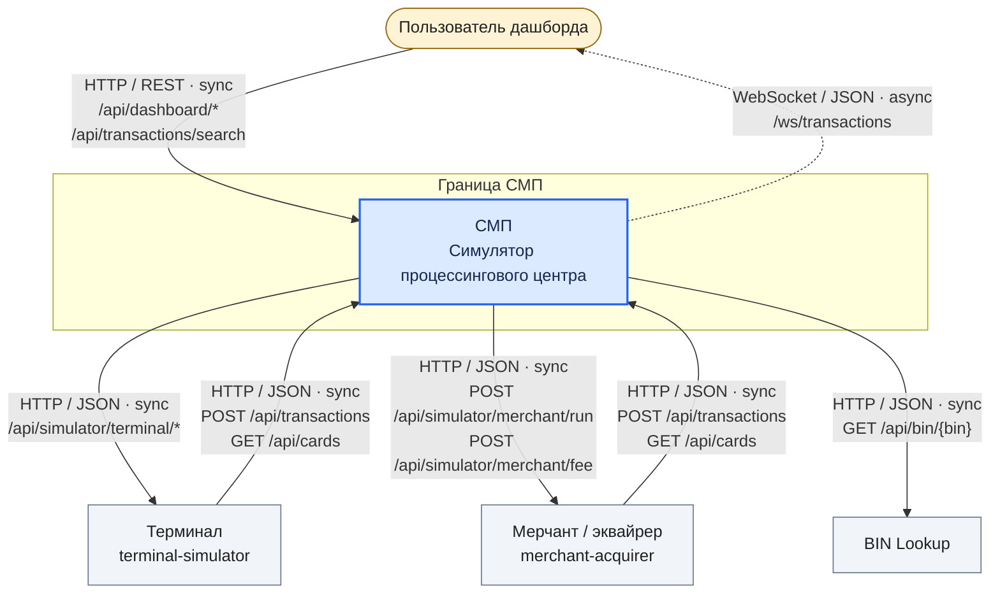

# А1. C4 Context

## Чего не хватало

Не было отдельной схемы, которая показывает границу СМП, внешних участников и способы связи с ними.

## Диаграмма

## Что я сделала

Я показала границу СМП, терминал, мерчанта/эквайрера, пользователя дашборда и внешний BIN Lookup. Подписала протоколы и пути API.

Сплошные стрелки показывают HTTP-запросы с ожиданием ответа. Пунктир показывает обновления через WebSocket.

## Подтверждение связей по коду

- **Терминал → СМП:** [GatewayClient.java](../../../services/terminal-simulator/src/main/java/com/processing/terminalsimulator/client/GatewayClient.java): HTTP-запросы к Gateway и Card Management. [docker-compose.yaml](../../../docker-compose.yaml): адреса этих сервисов для терминала.
- **СМП → терминал:** [application.yml](../../../services/gateway/src/main/resources/application.yml): маршрут Gateway к симулятору. [TerminalSimulatorController.java](../../../services/terminal-simulator/src/main/java/com/processing/terminalsimulator/controller/TerminalSimulatorController.java): приём HTTP-запросов.
- **Мерчант / эквайрер → СМП:** [GatewayClient.java](../../../services/merchant-acquirer/src/main/java/com/processing/merchantacquirer/client/GatewayClient.java): HTTP-запросы к Gateway.
- **СМП → мерчант / эквайрер:** [application.yml](../../../services/gateway/src/main/resources/application.yml): маршрут Gateway к симулятору. [MerchantAcquirerClient.java](../../../services/switch/src/main/java/com/processing/service/MerchantAcquirerClient.java): HTTP-запрос комиссии. [SimulationController.java](../../../services/merchant-acquirer/src/main/java/com/processing/merchantacquirer/controller/SimulationController.java): приём запросов запуска и расчёта комиссии.
- **Пользователь → СМП:** [nginx.conf](../../../services/dashboard/nginx.conf): доступ к дашборду и передача API-запросов в Gateway. [client.ts](../../../services/dashboard/src/api/client.ts): HTTP-запросы из браузера. [useStats.ts](../../../services/dashboard/src/hooks/useStats.ts) и [useTransactions.ts](../../../services/dashboard/src/hooks/useTransactions.ts): пути API статистики и поиска.
- **СМП → пользователь:** [useWebSocket.ts](../../../services/dashboard/src/hooks/useWebSocket.ts): WebSocket-соединение в браузере. [nginx.conf](../../../services/dashboard/nginx.conf): передача соединения в Logger. [TransactionService.java](../../../services/transaction-logger/src/main/java/com/processing/transactionlogger/service/TransactionService.java): отправка новых транзакций.
- **СМП → BIN Lookup:** [BinLookupClient.java](../../../services/authorization/src/main/java/com/processing/authorization/client/BinLookupClient.java): HTTP-запрос по BIN. [BinLookupController.java](../../../services/bin-lookup/src/main/java/com/processing/binlookup/controller/BinLookupController.java): приём запроса.
