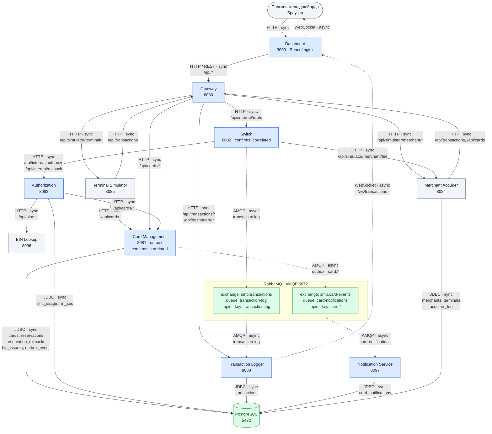

# А2. C4 Container

## Чего не хватало

В общей схеме сервисов не были разделены синхронные и асинхронные связи. Не были показаны outbox и настройки подтверждения публикации. Состав сервисов не был сверен с `docker-compose.yaml`.

## Диаграмма

## Что я сделала

Я сверила состав с Compose, порты с `.env.example`. Показала HTTP/JDBC, AMQP, WebSocket, outbox, exchanges и очереди. Сплошные стрелки обозначают sync, пунктирные обозначают async.

На схеме указаны порты доступа с компьютера. В сети Docker HTTP-сервисы используют `8080`, Dashboard использует `3000`.

## Особенности реализации

- В базовом Compose 10 прикладных сервисов. Отдельного одиннадцатого сервиса нет.
- К PostgreSQL подключаются Card Management, Authorization, Logger, Notification и Merchant Acquirer.
- У Switch и Card Management включён режим confirms `correlated`, но отправители не ждут подтверждения. Switch запускает откат при ошибке отправки одобренной транзакции.

## Подтверждение связей по коду

- **Состав и порты:** [docker-compose.yaml](../../../docker-compose.yaml), [.env.example](../../../.env.example).
- **Dashboard → Gateway, Logger → Dashboard:** [nginx.conf](../../../services/dashboard/nginx.conf), [useWebSocket.ts](../../../services/dashboard/src/hooks/useWebSocket.ts), [TransactionService.java](../../../services/transaction-logger/src/main/java/com/processing/transactionlogger/service/TransactionService.java): HTTP и WebSocket.
- **Терминал → Gateway и Card Management:** [GatewayClient.java](../../../services/terminal-simulator/src/main/java/com/processing/terminalsimulator/client/GatewayClient.java).
- **Мерчант → Gateway:** [GatewayClient.java](../../../services/merchant-acquirer/src/main/java/com/processing/merchantacquirer/client/GatewayClient.java).
- **Gateway → сервисы:** [application.yml](../../../services/gateway/src/main/resources/application.yml): маршруты и адреса.
- **Switch → Authorization и Merchant Acquirer:** [AuthorizationClient.java](../../../services/switch/src/main/java/com/processing/service/AuthorizationClient.java), [MerchantAcquirerClient.java](../../../services/switch/src/main/java/com/processing/service/MerchantAcquirerClient.java).
- **Authorization → Card Management, BIN Lookup и PostgreSQL:** [CardManagementClientImpl.java](../../../services/authorization/src/main/java/com/processing/authorization/client/CardManagementClientImpl.java), [BinLookupClient.java](../../../services/authorization/src/main/java/com/processing/authorization/client/BinLookupClient.java), [LimitUsageRepository.java](../../../services/authorization/src/main/java/com/processing/authorization/repositories/LimitUsageRepository.java).
- **Card Management → PostgreSQL:** [CardJpaRepository.java](../../../services/card-management/src/main/java/com/processing/cardmanagement/repositories/CardJpaRepository.java), [ReservationJpaRepository.java](../../../services/card-management/src/main/java/com/processing/cardmanagement/repositories/ReservationJpaRepository.java), [ReservationRollbackJpaRepository.java](../../../services/card-management/src/main/java/com/processing/cardmanagement/repositories/ReservationRollbackJpaRepository.java), [BinIssuerJpaRepository.java](../../../services/card-management/src/main/java/com/processing/cardmanagement/repositories/BinIssuerJpaRepository.java), [OutboxEventJpaRepository.java](../../../services/card-management/src/main/java/com/processing/cardmanagement/repositories/OutboxEventJpaRepository.java).
- **Logger и Notification → PostgreSQL:** [TransactionRepository.java](../../../services/transaction-logger/src/main/java/com/processing/transactionlogger/repository/TransactionRepository.java), [CardNotificationRepository.java](../../../services/notification-service/src/main/java/com/processing/notification/repository/CardNotificationRepository.java).
- **Merchant Acquirer → PostgreSQL:** [Merchant.java](../../../services/merchant-acquirer/src/main/java/com/processing/merchantacquirer/domain/entity/Merchant.java), [Terminal.java](../../../services/merchant-acquirer/src/main/java/com/processing/merchantacquirer/domain/entity/Terminal.java), [AcquirerFee.java](../../../services/merchant-acquirer/src/main/java/com/processing/merchantacquirer/domain/entity/AcquirerFee.java), [docker-compose.yaml](../../../docker-compose.yaml).
- **Switch → RabbitMQ → Logger:** [LoggerClient.java](../../../services/switch/src/main/java/com/processing/service/LoggerClient.java), [RabbitMQConfig.java](../../../services/switch/src/main/java/com/processing/config/RabbitMQConfig.java), [TransactionLogListener.java](../../../services/transaction-logger/src/main/java/com/processing/transactionlogger/listener/TransactionLogListener.java).
- **Outbox → RabbitMQ → Notification:** [OutboxEventProcessorImpl.java](../../../services/card-management/src/main/java/com/processing/cardmanagement/services/OutboxEventProcessorImpl.java), [RabbitMQConfig.java](../../../services/card-management/src/main/java/com/processing/cardmanagement/config/RabbitMQConfig.java), [CardEventListener.java](../../../services/notification-service/src/main/java/com/processing/notification/listener/CardEventListener.java).
- **Publisher confirms и откат:** [application.yml](../../../services/switch/src/main/resources/application.yml), [application.properties](../../../services/card-management/src/main/resources/application.properties), [RouteService.java](../../../services/switch/src/main/java/com/processing/service/RouteService.java).
