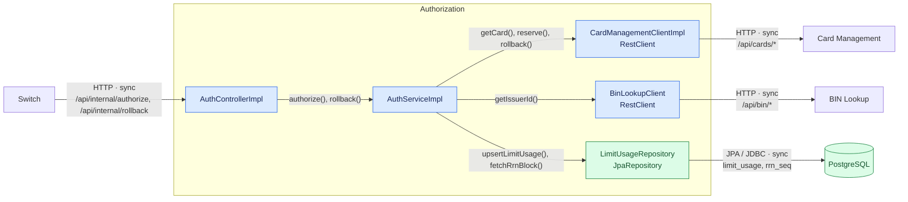
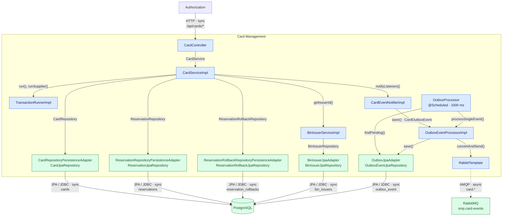

# А3. C4 Component: Authorization и Card Management

## Чего не хватало

Не было схемы внутренних компонентов Authorization и Card Management: контроллеров, бизнес-логики, HTTP-клиентов, доступа к базе данных и обработки outbox.

## Диаграмма

### Authorization

### Card Management

## Что я сделала

Я показала контроллеры, сервисы, HTTP-клиенты и репозитории Authorization и Card Management. Отдельно показала сохранение outbox и его публикацию через RabbitTemplate.

HTTP и JDBC отмечены как sync, AMQP отмечен как async. Внутренние вызовы подписаны методами и интерфейсами.

## Особенности реализации

Outbox повторно обрабатывается при следующем запуске. Пауза после завершения обработчика по умолчанию равна 1000 мс и не растёт. После трёх ошибок публикации событие получает `FAILED`.

## Подтверждение связей по коду

### Authorization

- **Контроллер → бизнес-логика Authorization:** [AuthControllerImpl.java](../../../services/authorization/src/main/java/com/processing/authorization/controller/AuthControllerImpl.java), [AuthServiceImpl.java](../../../services/authorization/src/main/java/com/processing/authorization/services/AuthServiceImpl.java).
- **HTTP-клиенты Authorization:** [CardManagementClientImpl.java](../../../services/authorization/src/main/java/com/processing/authorization/client/CardManagementClientImpl.java), [BinLookupClient.java](../../../services/authorization/src/main/java/com/processing/authorization/client/BinLookupClient.java).
- **Authorization → PostgreSQL:** [LimitUsageRepository.java](../../../services/authorization/src/main/java/com/processing/authorization/repositories/LimitUsageRepository.java).

### Card Management

- **Контроллер → бизнес-логика Card Management:** [CardController.java](../../../services/card-management/src/main/java/com/processing/cardmanagement/controllers/CardController.java), [CardServiceImpl.java](../../../services/card-management/src/main/java/com/processing/cardmanagement/services/CardServiceImpl.java).
- **Определение эмитента:** [BinIssuerServiceImpl.java](../../../services/card-management/src/main/java/com/processing/cardmanagement/services/BinIssuerServiceImpl.java), [BinIssuerJpaAdapter.java](../../../services/card-management/src/main/java/com/processing/cardmanagement/repositories/BinIssuerJpaAdapter.java).
- **Доступ к картам и резервированиям:** [CardRepositoryPersistenceAdapter.java](../../../services/card-management/src/main/java/com/processing/cardmanagement/repositories/CardRepositoryPersistenceAdapter.java), [ReservationRepositoryPersistenceAdapter.java](../../../services/card-management/src/main/java/com/processing/cardmanagement/repositories/ReservationRepositoryPersistenceAdapter.java), [ReservationRollbackRepositoryPersistenceAdapter.java](../../../services/card-management/src/main/java/com/processing/cardmanagement/repositories/ReservationRollbackRepositoryPersistenceAdapter.java).
- **Транзакции и блокировки:** [TransactionRunnerImpl.java](../../../services/card-management/src/main/java/com/processing/cardmanagement/services/TransactionRunnerImpl.java), [CardJpaRepository.java](../../../services/card-management/src/main/java/com/processing/cardmanagement/repositories/CardJpaRepository.java).
- **Событие → outbox → RabbitMQ:** [CardEventNotifierImpl.java](../../../services/card-management/src/main/java/com/processing/cardmanagement/events/CardEventNotifierImpl.java), [OutboxProcessor.java](../../../services/card-management/src/main/java/com/processing/cardmanagement/services/OutboxProcessor.java), [OutboxEventProcessorImpl.java](../../../services/card-management/src/main/java/com/processing/cardmanagement/services/OutboxEventProcessorImpl.java), [OutboxJpaAdapter.java](../../../services/card-management/src/main/java/com/processing/cardmanagement/repositories/OutboxJpaAdapter.java).
- **Сборка компонентов и настройки:** [AppConfig.java](../../../services/card-management/src/main/java/com/processing/cardmanagement/configuration/AppConfig.java), [RabbitMQConfig.java](../../../services/card-management/src/main/java/com/processing/cardmanagement/config/RabbitMQConfig.java), [application.properties](../../../services/card-management/src/main/resources/application.properties).
