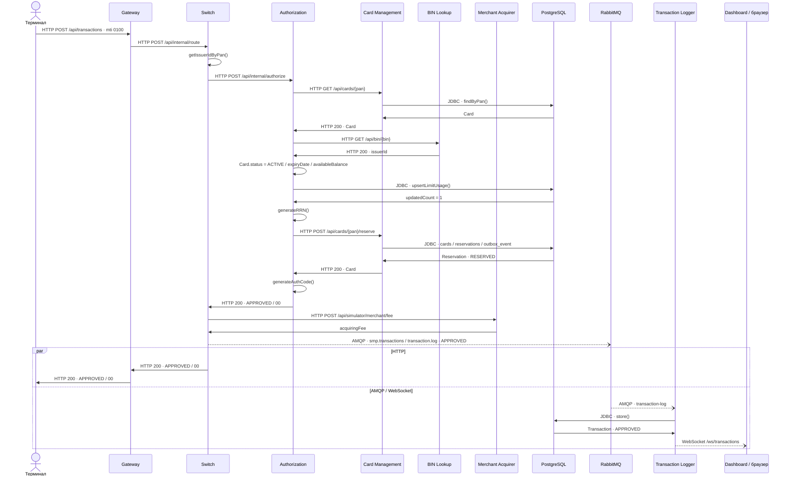
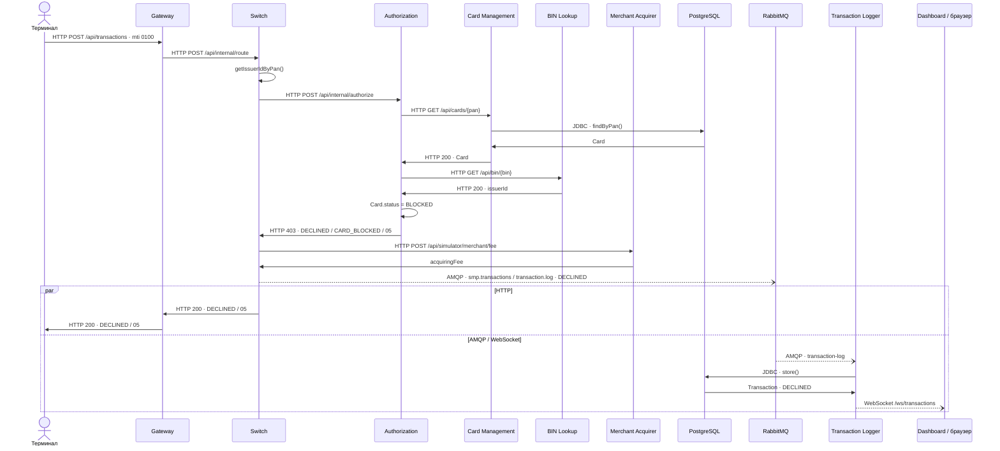
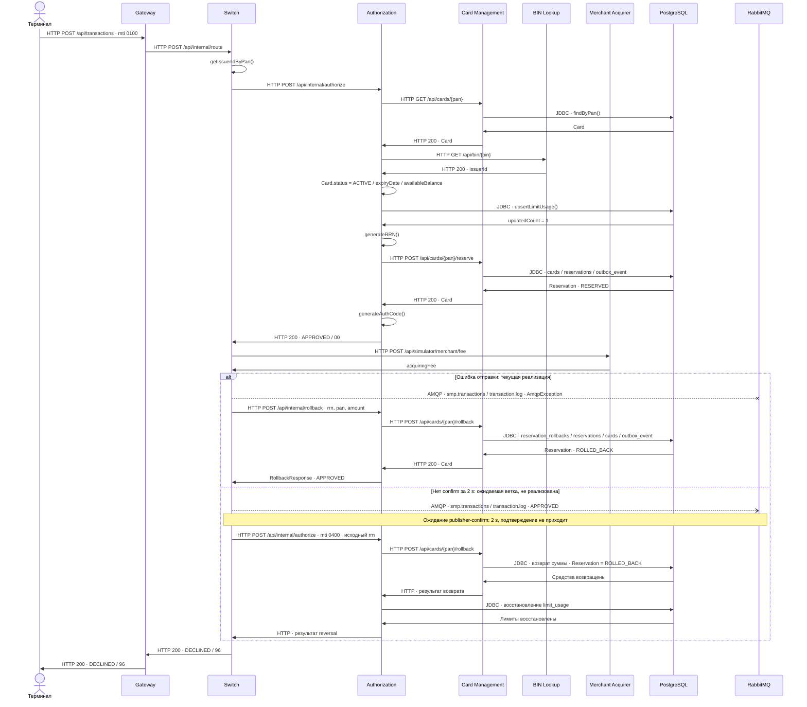

# А4. Sequence: путь транзакции

## Чего не хватало

Отказ заблокированной карте и откат резервирования не были подробно разобраны. Не были показаны границы между HTTP-вызовами и асинхронной доставкой сообщений.

## Диаграмма

### Успешный платёж

### Отказ: заблокированная карта

### Откат резервирования

## Что я сделала

Я показала полный путь успешного платежа, отказа заблокированной карте и отката. В третьей схеме разделила текущий `/rollback` и ожидаемую ветку `mti=0400`, которой в коде нет.

HTTP и JDBC показаны сплошными стрелками, AMQP и WebSocket показаны пунктиром. Запись в Logger может появиться до ответа клиенту или после него. В текущем откате показан успешный возврат средств. При неудаче отката Switch тоже возвращает `DECLINED / 96`.

## Особенности реализации

- Switch не ждёт publisher-confirm две секунды. Ошибка отправки одобренной транзакции запускает отдельный `/rollback` без поля `mti`.
- `AuthorizationRequest.forReversal()` не вызывается и не передаёт исходный RRN. Gateway принимает только `mti=0100`.
- `AuthServiceImpl.rollback()` возвращает средства через Card Management, но не восстанавливает `limit_usage`.

## Подтверждение связей по коду

- **Терминал → Gateway → Switch:** [GatewayClient.java](../../../services/terminal-simulator/src/main/java/com/processing/terminalsimulator/client/GatewayClient.java), [application.yml](../../../services/gateway/src/main/resources/application.yml).
- **Маршрутизация, комиссия, публикация и откат:** [RouteService.java](../../../services/switch/src/main/java/com/processing/service/RouteService.java), [RoutingService.java](../../../services/switch/src/main/java/com/processing/service/RoutingService.java), [MerchantAcquirerClient.java](../../../services/switch/src/main/java/com/processing/service/MerchantAcquirerClient.java).
- **MTI и неиспользуемый метод reversal:** [AuthorizationRequest.java](../../../services/common/src/main/java/com/processing/common/dto/authorization/AuthorizationRequest.java), [TransactionRequestValidator.java](../../../services/gateway/src/main/java/com/processing/gateway/validation/TransactionRequestValidator.java).
- **Switch → Authorization:** [AuthorizationClient.java](../../../services/switch/src/main/java/com/processing/service/AuthorizationClient.java): авторизация и отдельный `/rollback`.
- **Проверки карты, баланс, лимиты, RRN и authCode:** [AuthServiceImpl.java](../../../services/authorization/src/main/java/com/processing/authorization/services/AuthServiceImpl.java), [LimitUsageRepository.java](../../../services/authorization/src/main/java/com/processing/authorization/repositories/LimitUsageRepository.java).
- **HTTP-ответы и причины отказов:** [AuthControllerImpl.java](../../../services/authorization/src/main/java/com/processing/authorization/controller/AuthControllerImpl.java), [DeclineOutcome.java](../../../services/authorization/src/main/java/com/processing/authorization/constants/DeclineOutcome.java), [RouteController.java](../../../services/switch/src/main/java/com/processing/controller/RouteController.java).
- **Authorization → Card Management и BIN Lookup:** [CardManagementClientImpl.java](../../../services/authorization/src/main/java/com/processing/authorization/client/CardManagementClientImpl.java), [BinLookupClient.java](../../../services/authorization/src/main/java/com/processing/authorization/client/BinLookupClient.java).
- **Резервирование и возврат средств:** [CardServiceImpl.java](../../../services/card-management/src/main/java/com/processing/cardmanagement/services/CardServiceImpl.java), [Card.java](../../../services/card-management/src/main/java/com/processing/cardmanagement/models/Card.java), [Reservation.java](../../../services/card-management/src/main/java/com/processing/cardmanagement/models/Reservation.java).
- **Публикация транзакции:** [LoggerClient.java](../../../services/switch/src/main/java/com/processing/service/LoggerClient.java), [application.yml](../../../services/switch/src/main/resources/application.yml): режим confirms включён, ожидания подтверждения в клиенте нет.
- **RabbitMQ → Logger → PostgreSQL и WebSocket:** [TransactionLogListener.java](../../../services/transaction-logger/src/main/java/com/processing/transactionlogger/listener/TransactionLogListener.java), [TransactionService.java](../../../services/transaction-logger/src/main/java/com/processing/transactionlogger/service/TransactionService.java), [useWebSocket.ts](../../../services/dashboard/src/hooks/useWebSocket.ts).

- **Ожидание confirm и reversal:** [03-switch.md](../../../tz/03-switch.md), [04-authorization.md](../../../tz/04-authorization.md). Это источники ожидаемой ветки, которой нет в реализации.
