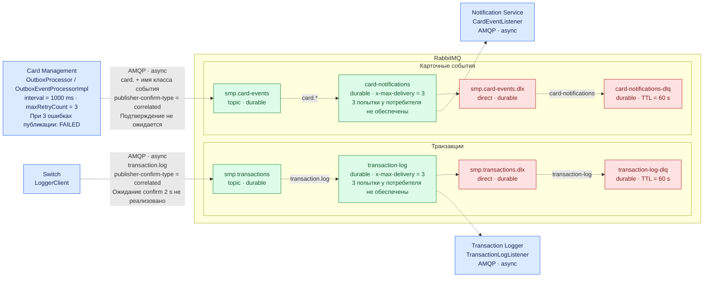

# А5. RabbitMQ: exchanges, очереди и потребители

## Чего не хватало

Связи RabbitMQ были описаны текстом и таблицей. Не было отдельной схемы с exchanges, очередями, потребителями и очередями для сообщений, которые не удалось обработать.

## Диаграмма

## Что я сделала

Я показала оба пути сообщений, routing keys, потребителей, DLX и DLQ. Разделила повторы публикации outbox и повторы обработки потребителем. TTL 60 секунд задан у DLQ.

## Особенности реализации

- Отправители не ждут publisher-confirm. Успех отправки и статус outbox `PROCESSED` ещё не подтверждают доставку потребителю.
- Outbox повторяет публикацию после ошибки при следующем запуске обработчика. После трёх ошибок событие получает `FAILED`. Пауза по умолчанию равна 1000 мс после завершения обработчика, без увеличения.
- У основных очередей задан `x-max-delivery=3`, но retry потребителей не настроен. Доставка ровно три раза и последующий переход в DLQ не обеспечены. Стрелки к DLX показывают настроенные dead-letter-связи.

## Подтверждение связей по коду

- **Switch → exchange транзакций:** [LoggerClient.java](../../../services/switch/src/main/java/com/processing/service/LoggerClient.java), [RabbitMQConfig.java](../../../services/switch/src/main/java/com/processing/config/RabbitMQConfig.java): публикация, exchange, основная очередь, DLX и DLQ.
- **Очередь транзакций → Logger:** [RabbitMQConfig.java](../../../services/transaction-logger/src/main/java/com/processing/transactionlogger/config/RabbitMQConfig.java), [TransactionLogListener.java](../../../services/transaction-logger/src/main/java/com/processing/transactionlogger/listener/TransactionLogListener.java).
- **Outbox → exchange карточных событий:** [OutboxProcessor.java](../../../services/card-management/src/main/java/com/processing/cardmanagement/services/OutboxProcessor.java), [OutboxEventProcessorImpl.java](../../../services/card-management/src/main/java/com/processing/cardmanagement/services/OutboxEventProcessorImpl.java), [RabbitMQConfig.java](../../../services/card-management/src/main/java/com/processing/cardmanagement/config/RabbitMQConfig.java).
- **Очередь карточных событий → Notification:** [RabbitMQConfig.java](../../../services/notification-service/src/main/java/com/processing/notification/config/RabbitMQConfig.java), [CardEventListener.java](../../../services/notification-service/src/main/java/com/processing/notification/listener/CardEventListener.java).
- **Счётчик повторов outbox:** [CardOutboxEventData.java](../../../services/card-management/src/main/java/com/processing/cardmanagement/models/CardOutboxEventData.java), [OutboxJpaAdapter.java](../../../services/card-management/src/main/java/com/processing/cardmanagement/repositories/OutboxJpaAdapter.java), [application.properties](../../../services/card-management/src/main/resources/application.properties).
- **Confirms и настройки потребителей:** [application.yml Switch](../../../services/switch/src/main/resources/application.yml), [application.properties Card Management](../../../services/card-management/src/main/resources/application.properties), [application.yaml Logger](../../../services/transaction-logger/src/main/resources/application.yaml), [application.yml Notification](../../../services/notification-service/src/main/resources/application.yml).
