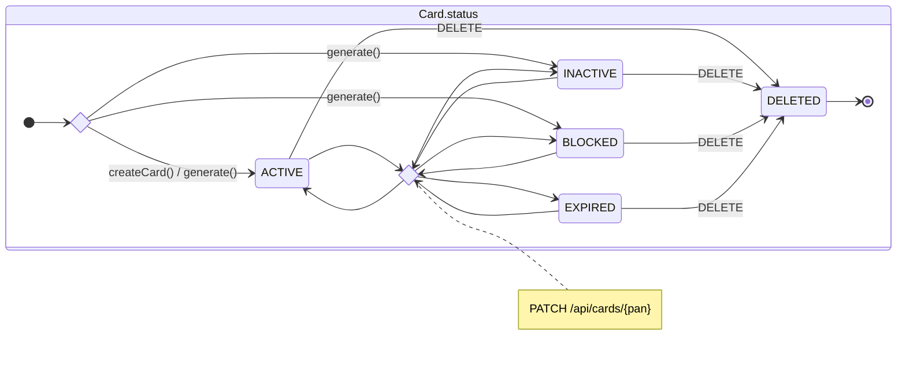
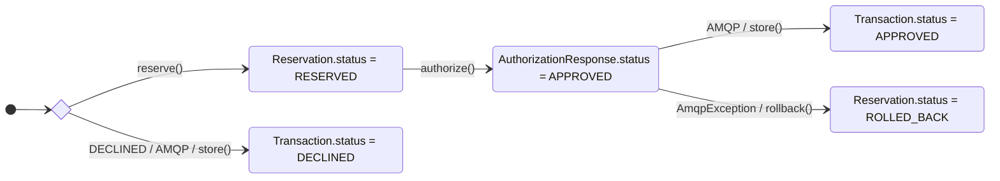

# А6. Состояния карты и транзакции

## Чего не хватало

Не было схемы состояний карты и пути от решения об авторизации до сохранения транзакции или отката резервирования.

## Диаграмма

### Карта

### Транзакция и резервирование

## Что я сделала

Я показала состояния карты, изменение статуса через PATCH и мягкое удаление. Разделила результат авторизации, запись в Logger и состояние резервирования.

Ветка сохранения транзакции предполагает успешную доставку через AMQP. Откат меняет `Reservation.status` и баланс карты. Статус уже сохранённой транзакции при этом не меняется.

## Особенности реализации

- У `Transaction.status` есть только `APPROVED` и `DECLINED`. `ROLLED_BACK` хранится у `Reservation.status`.
- PATCH позволяет установить любой из четырёх статусов API. DELETE устанавливает `DELETED`, такие карты исключаются из запросов.
- Автоматического перехода в `EXPIRED` по дате нет. Authorization отклоняет просроченную карту без изменения её статуса.

## Подтверждение связей по коду

- **Состояния карты:** [CardStatus.java](../../../services/card-management/src/main/java/com/processing/cardmanagement/models/CardStatus.java), [CardModelStatus.java](../../../services/common/src/main/java/com/processing/common/dto/cardmanagement/CardModelStatus.java): пять состояний в модели, четыре в API.
- **Начальные статусы:** [CardServiceImpl.java](../../../services/card-management/src/main/java/com/processing/cardmanagement/services/CardServiceImpl.java): создание активной карты. [CardGeneratorService.java](../../../services/card-management/src/main/java/com/processing/cardmanagement/services/CardGeneratorService.java): генерация `ACTIVE`, `INACTIVE` и `BLOCKED`.
- **PATCH и DELETE:** [CardController.java](../../../services/card-management/src/main/java/com/processing/cardmanagement/controllers/CardController.java), [PatchCardRequest.java](../../../services/common/src/main/java/com/processing/common/dto/cardmanagement/PatchCardRequest.java), [CardServiceImpl.java](../../../services/card-management/src/main/java/com/processing/cardmanagement/services/CardServiceImpl.java), [Card.java](../../../services/card-management/src/main/java/com/processing/cardmanagement/models/Card.java).
- **Удалённые карты:** [CardEntity.java](../../../services/card-management/src/main/java/com/processing/cardmanagement/models/CardEntity.java): фильтр `status <> 'DELETED'`.
- **Отказ по статусу и сроку действия:** [AuthServiceImpl.java](../../../services/authorization/src/main/java/com/processing/authorization/services/AuthServiceImpl.java), [DeclineOutcome.java](../../../services/authorization/src/main/java/com/processing/authorization/constants/DeclineOutcome.java).
- **Статусы транзакции и ответа:** [TransactionStatus.java](../../../services/common/src/main/java/com/processing/common/dto/transactionlogger/TransactionStatus.java), [AuthorizationResponse.java](../../../services/common/src/main/java/com/processing/common/dto/authorization/AuthorizationResponse.java).
- **RESERVED → ROLLED_BACK:** [ReservationStatus.java](../../../services/card-management/src/main/java/com/processing/cardmanagement/models/ReservationStatus.java), [Reservation.java](../../../services/card-management/src/main/java/com/processing/cardmanagement/models/Reservation.java), [CardServiceImpl.java](../../../services/card-management/src/main/java/com/processing/cardmanagement/services/CardServiceImpl.java).
- **Статус транзакции и откат при ошибке публикации:** [RouteService.java](../../../services/switch/src/main/java/com/processing/service/RouteService.java), [LoggerClient.java](../../../services/switch/src/main/java/com/processing/service/LoggerClient.java).
- **Сохранение статуса в Logger:** [TransactionLogListener.java](../../../services/transaction-logger/src/main/java/com/processing/transactionlogger/listener/TransactionLogListener.java), [TransactionService.java](../../../services/transaction-logger/src/main/java/com/processing/transactionlogger/service/TransactionService.java).
